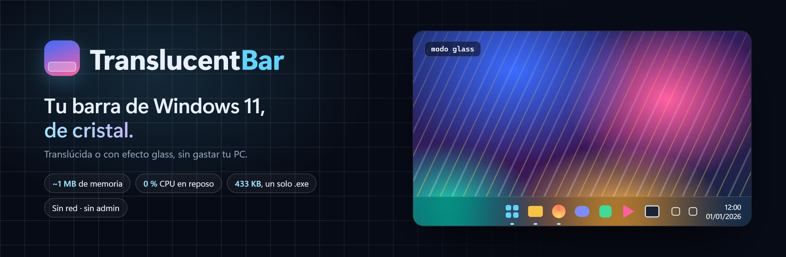
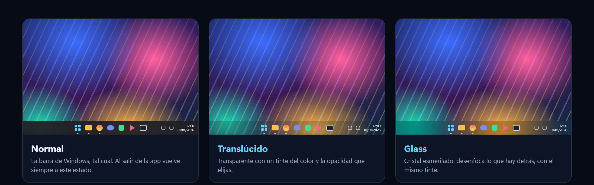
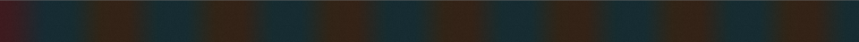

<p align="center">
  
</p>

<p align="center">
  
  
  
  
</p>

<p align="center">
  <b>La barra de tareas de Windows 11, translúcida o con efecto glass.</b><br>
  Un único <code>.exe</code> de 433 KB, sin instalador, sin administrador, sin red y sin gastar tu PC en reposo.
</p>

<p align="center">
  <a href="#descarga">Descarga</a> ·
  <a href="#modos">Modos</a> ·
  <a href="#consumo-real">Consumo real</a> ·
  <a href="#cómo-funciona">Cómo funciona</a> ·
  <a href="#seguridad-y-transparencia">Seguridad</a> ·
  <a href="#compilar">Compilar</a>
</p>

---

## Por qué existe

Las utilidades para personalizar la barra de tareas suelen arrastrar un runtime entero (.NET, Electron…), se quedan revisando la barra con temporizadores y acaban ocupando decenas de megas para hacer algo muy pequeño.

TranslucentBar hace lo mismo **sin peso muerto**:

- **Nativo de verdad.** C++20 y Win32, sin frameworks. Un solo `.exe` de 433 KB.
- **Cero sondeo.** No hay temporizadores ni bucles: duerme en `GetMessage` y solo despierta cuando Windows avisa de un cambio.
- **Reversible.** Al salir, o si se cierra de golpe, la barra vuelve a estar como estaba.
- **Sin red, sin telemetría y sin administrador.** No toca archivos del sistema ni parchea Explorer.

## Modos

<p align="center"></p>

<sub>Recreación ilustrativa con iconos genéricos. Las capturas reales están debajo.</sub>

| Modo | Qué hace |
|---|---|
| **Translúcido** | Fondo transparente con un tinte RGB y una opacidad de 0 a 100 % |
| **Glass** | Cristal acrílico de Windows: desenfoca lo que hay detrás, con el mismo tinte |
| **Normal** | Recupera los pinceles originales de Windows |

**Capturas reales** de la barra sobre franjas de color, recortadas para no mostrar iconos:

| Translúcido | Glass | Normal |
|---|---|---|
|  |  |  |

## Descarga

1. Descarga **`TranslucentBar.exe`** de la última versión en [Releases](../../releases).
2. *(Recomendado)* Comprueba su hash con el que aparece en la Release:
   ```powershell
   Get-FileHash .\TranslucentBar.exe -Algorithm SHA256
   ```
3. Ábrelo. Aparece un icono en la bandeja del sistema (puede estar en los iconos ocultos, junto a la flecha `^`).

> [!NOTE]
> El ejecutable no está firmado con un certificado de pago, así que **Windows SmartScreen** puede avisar la primera vez: *Más información → Ejecutar de todas formas*. Si prefieres no fiarte del binario, [compílalo tú](#compilar): la compilación es reproducible y debe darte el mismo SHA256.

**Requisitos:** Windows 11 x64. Probado en 26H2 (compilación 26300) con dos pantallas. Está pensado también para 24H2 y 25H2, pero aún no se ha probado en esas versiones.

### Menú de la bandeja

- **Translúcido / Glass / Normal**
- **Color del tinte…** (selector de color de Windows) y **Opacidad del tinte**, en pasos del 5 %
- **Iniciar con Windows**: usa `HKCU\…\Run`, sin administrador. Viene desactivado.
- **Estado y diagnóstico…**
- **Salir y restaurar la barra**

También se controla por línea de comandos: `TranslucentBar.exe --modo glass | translucido | normal`, `--menu`, `--estado` y `--salir`.

La configuración ocupa unos 80 bytes en `%APPDATA%\TranslucentBar\config.json`:

```json
{ "modo": "glass", "color": "#172535", "opacidad": 25 }
```

## Consumo real

Medido con `Get-Process` y los contadores de rendimiento de Windows, sin recortar la memoria artificialmente. Windows 11 26H2 (compilación 26300.9711), modo translúcido (opacidad 0 %), dos barras, el 27 de octubre de 2026:

| Momento | Memoria privada en uso¹ | Working set total² | CPU |
|---|---:|---:|---:|
| Arranque en frío (2 s) | **1,13 MB** | 10,38 MB | 0 s |
| Reposo (30 s – 3 min) | **1,09 MB** | 10,33 MB | 0,06 s en 3 min (≈ 0,03 % de un núcleo) |
| Después de abrir menús y el selector de color | 3,16 MB | 22,38 MB | — |

¹ *Working set privado*: es lo que muestra la columna **«Memoria»** del Administrador de tareas.
² Incluye las páginas de DLL de Windows compartidas con otros procesos, que ya están en memoria de todas formas.

El efecto en sí lo pinta Windows: hay un pequeño puente dentro de Explorer y el compositor dibuja el material. Ese coste no está incluido en las cifras de arriba, que son las del proceso `TranslucentBar`. Hay más detalle en [docs/TECNICO.md](docs/TECNICO.md#consumo-medido) y [docs/mediciones-reposo.json](docs/mediciones-reposo.json). Puedes repetir la medición con `scripts\medir.ps1`.

## Cómo funciona

La barra de Windows 11 no es una ventana clásica: dentro lleva un árbol **XAML**. Por eso los trucos antiguos (`SetWindowCompositionAttribute`, el backdrop de DWM) ya no bastan.

TranslucentBar usa la **API pública de diagnóstico XAML de Microsoft** (`InitializeXamlDiagnosticsEx`). Con ella localiza los rectángulos de fondo de la barra (`BackgroundFill` y `BackgroundStroke`) y cambia su pincel:

- **Translúcido:** `SolidColorBrush` con tu color y opacidad.
- **Glass:** `AcrylicBrush` con `BackgroundSource=Backdrop`.

Antes de cambiarlo guarda el pincel original y lo restaura al salir. Si Explorer lo reemplaza, se entera por un *callback* de la propiedad y lo vuelve a aplicar.

Todo funciona **por eventos**:
- `SetWinEventHook` detecta barras nuevas y cambios de posición;
- el mensaje `TaskbarCreated` avisa cuando Explorer se reinicia;
- también reacciona a cambios de pantalla, DPI, tema y composición.

Si TranslucentBar muere, incluso con `Stop-Process`, una espera del sistema avisa al puente y la barra se restaura.

Todos los detalles, las alternativas evaluadas y por qué se descartaron están en **[docs/TECNICO.md](docs/TECNICO.md)**.

## Seguridad y transparencia

- **Sin red:** el programa no abre conexiones ni envía datos.
- **Sin administrador:** se ejecuta como tu usuario (`asInvoker`). No escribe en `HKLM` ni en carpetas del sistema.
- **El puente en Explorer:** la API de diagnóstico XAML exige cargar una DLL dentro de Explorer. Va incrustada en el `.exe` y se extrae, verificando sus bytes, a `%APPDATA%\TranslucentBar\puente-<hash>.dll`. Solo cambia los pinceles del fondo de la barra. Queda inactiva al salir y desaparece al reiniciar Explorer.
- **Antivirus:** como carga código en Explorer, algún antivirus heurístico podría marcarlo. Todo el código está aquí ([src/bridge.cpp](src/bridge.cpp), [src/main.cpp](src/main.cpp)). Revísalo o compílalo tú.
- **Para desinstalarlo:** desactiva «Iniciar con Windows», sal desde el menú, borra el `.exe` y, tras reiniciar Explorer, borra `%APPDATA%\TranslucentBar`.

## Compilar

Solo necesitas **LLVM-MinGW**, que se instala sin administrador y sin Visual Studio:

```powershell
winget install --id MartinStorsjo.LLVM-MinGW.UCRT --exact --scope user
.\build.ps1        # → out\TranslucentBar.exe
.\test.ps1         # 16 pruebas de configuración + inicio con Windows
```

La compilación es reproducible: sin marca de tiempo, con LTO y optimización de tamaño. El mismo código produce el mismo SHA256 que el `.exe` de la Release.

## Limitaciones conocidas

- Por ahora solo se ha probado en **Windows 11 26H2**. Si lo usas en 24H2 o 25H2, [cuéntanos](../../issues) qué tal.
- Solo hay versión **x64**, no ARM64.
- Los nombres internos de la barra XAML pueden cambiar con una actualización de Windows. Si eso pasa, la barra se queda normal y el diagnóstico muestra el error.
- Windows puede desactivar el acrílico en modo ahorro de energía o por accesibilidad.
- No es compatible con otras utilidades que modifiquen la misma barra al mismo tiempo.

## Licencia

[GNU GPL v3 o posterior](LICENSE) (`GPL-3.0-or-later`). Úsalo, estúdialo, modifícalo y compártelo. Cualquier versión que se distribuya debe incluir su código fuente bajo la misma licencia.

<sub>Hecho por <a href="https://github.com/zevidaun">zevidaun</a>. También: <a href="https://github.com/zevidaun/Z.-Optimizer">Z. Optimizer</a>, un optimizador de Windows 11 sin humo.</sub>
